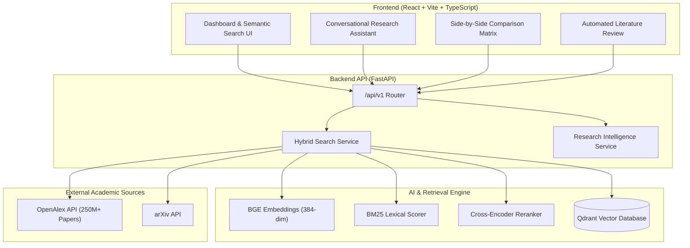

# Research Paper Intelligence (ResearchMind AI)

An end-to-end AI-powered research discovery, literature synthesis, and paper comparison platform. Combines global scholarly ingestion, dense vector search, lexical keyword matching, and cross-encoder neural reranking with a modern React dashboard.

---

## Key Capabilities

- **Global Dynamic Literature Discovery:** Real-time retrieval across 250M+ scholarly works using the **OpenAlex API** and **arXiv API** with automated acronym expansion (e.g. `DL` → `Deep Learning`).
- **Two-Stage Hybrid Retrieval:**
  - **Stage 1 (Dense Vector + BM25):** Vector embeddings using `BAAI/bge-small-en-v1.5` combined with `BM25Okapi` lexical matching (tunable `hybrid_weight`).
  - **Stage 2 (Cross-Encoder Reranker):** Neural cross-attention reranking via `cross-encoder/ms-marco-MiniLM-L-6-v2` for precise answer ranking.
- **Parametric Filtering:** Filter research papers by publication recency (*Last 2 Years*, *Last 5 Years*, custom year) and publication venue (*arXiv*, *IEEE*, *ACM*, *Nature*, *Sensors*, etc.).
- **One-Click Paper Executive Summary:** Instant 4-point structured breakdown covering *Core Objective*, *Methodology*, *Key Findings*, and *Limitations*.
- **"Chat like GPT" Research Assistant:** Conversational RAG grounded strictly in scientific literature with formal academic citations (`[Author et al., Year]`) and suggested follow-up chips.
- **Multi-Paper Method Comparison:** Side-by-side comparative matrix across 2 to 5 papers evaluating objectives, architectures, datasets, and trade-offs.
- **Automated Literature Review Synthesizer:** Thematic clustering of research papers with automated extraction of unexplored research gaps.
- **Interactive React Frontend:** Glassmorphic modern interface with real-time score indicators, interactive modals, and responsive layout.

---

## Architecture Overview



---

## Technology Stack

- **Backend:** Python 3.11, FastAPI, Uvicorn, Pydantic v2, Qdrant Client, rank-bm25, PyTorch, Transformers, Sentence-Transformers.
- **Frontend:** React 18, TypeScript, Vite, Tailwind-free custom CSS, Lucide icons.
- **Vector DB:** Qdrant (local persistent embedded storage with HNSW index).
- **Testing:** Pytest, pytest-asyncio (19 / 19 passing tests).
- **DevOps:** Docker, Docker Compose, GitHub Actions CI.

---

## Project Structure

```text
ResearchMindAI/
├── backend/
│   ├── app/
│   │   ├── api/v1/         # Endpoints: search, research (chat, summary, compare, synthesize), health
│   │   ├── ai/             # Embeddings, cross-encoder reranker, model interfaces
│   │   ├── core/           # Configuration, logging, exception handlers, middleware
│   │   ├── schemas/        # Pydantic data schemas
│   │   ├── services/       # Search service, vector store, academic client, research service
│   │   └── main.py         # FastAPI application entrypoint
│   └── tests/              # Comprehensive unit and integration test suite
├── frontend/
│   ├── src/
│   │   ├── components/     # Sidebar, PaperModal, SummaryModal
│   │   ├── api.ts          # API client for backend endpoints
│   │   ├── App.tsx         # Main dashboard and tab router
│   │   └── index.css       # Design system and custom styles
│   ├── index.html
│   ├── vite.config.ts
│   └── package.json
├── data/                   # Data storage configuration
├── docs/                   # Architectural documentation
├── docker-compose.yml
├── Dockerfile
├── requirements.txt
└── pyproject.toml
```

---

## Getting Started

### 1. Backend Setup

```powershell
# Create and activate virtual environment
python -m venv .venv
.venv\Scripts\activate

# Install dependencies
pip install -r requirements.txt

# Run FastAPI backend
python -m uvicorn backend.app.main:app --host 127.0.0.1 --port 8001 --reload
```
Interactive API documentation will be available at: **http://127.0.0.1:8001/api/v1/docs**

### 2. Frontend Setup

```powershell
cd frontend
npm install
npm run dev
```
Open **http://localhost:3000** in your browser.

### 3. Running Tests

```powershell
pytest backend/tests
```

---

## License

MIT License. See [LICENSE](LICENSE) for details.

